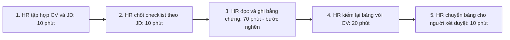
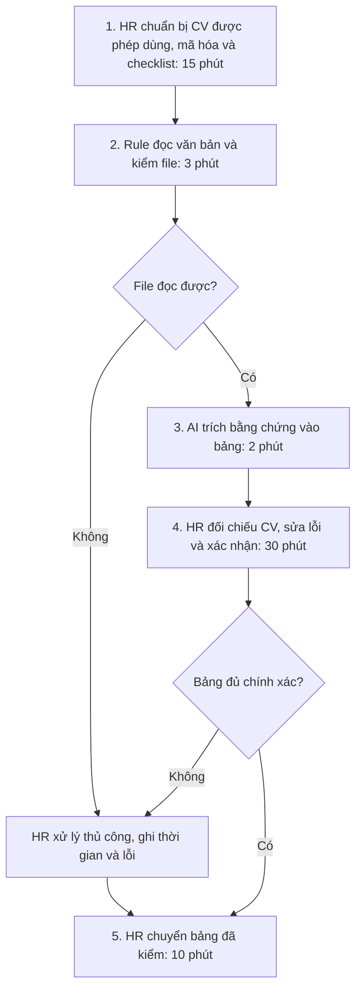

# Báo cáo nhóm — Day 02 Discovery & Problem Framing

> **Bản dự thảo để nhóm Kyori duyệt.** Thông tin đã được cung cấp: tên/MSSV ba thành viên, 3 vấn đề của Vũ Thanh Toàn, 3 card của Trần Minh Tân và việc nhóm chọn sàng lọc CV. Phần còn lại là đề xuất hoặc kịch bản giả định, được đánh dấu tại từng mục. Chưa có phỏng vấn người thật, đo thời gian, thử công cụ hoặc xác nhận phân công. Research dùng tài liệu chính thức đã mở kiểm tra ngày 09/11/2026. Không coi mô phỏng là bằng chứng CP4.

## 1. Thông tin nhóm

- Tên nhóm: Kyori.
- Thành viên: Vũ Thanh Toàn — 2A202603654; Trần Minh Tân — 2A202603688; Phạm Cát Tân — 2A202603678.
- Repo: https://github.com/kyo708/K5-L3A-Day02-Kyori-DiscoveryProblemFraming
- Candidate problem được chọn: **Khi nhận nhiều CV cho một vị trí tuyển dụng, HR mất thời gian đọc và đối chiếu thông tin trình bày không đồng nhất với yêu cầu công việc để chuẩn bị hồ sơ cho bước xét duyệt tiếp theo.**
- Phạm vi đề xuất: một vị trí Junior Backend Developer; hỗ trợ trích xuất bằng chứng về kinh nghiệm, kỹ năng và dự án; không tự chấm điểm, xếp hạng hay loại ứng viên.
- Quyết định cuối dự thảo: **Not Yet đối với triển khai thực tế**; chuẩn bị phép thử ngoại tuyến trên dữ liệu giả lập trước. Nhóm cần duyệt kết luận này.

## 2. Hội tụ nhóm (CP3)

### 2.1. Danh sách candidate và câu hỏi chuẩn bị thảo luận

Nhóm chọn candidate #1 là thông tin đã xác nhận qua Trần Minh Tân. Chưa có biên bản pitch hoặc lịch sử ai hỏi ai; cột cuối là câu hỏi đề xuất, không phải lời phản biện đã xảy ra. Ba ý của Phạm Cát Tân là gợi ý bổ sung để thành viên duyệt, không được gán là ý tưởng đã trình bày.

| # | Nguồn | Candidate dạng Job Story ngắn | Actor | Bottleneck giả thuyết | Câu hỏi chuẩn bị phản biện |
|---:|---|---|---|---|---|
| 1 | Vũ Thanh Toàn — đã cung cấp chủ đề | Khi nhận nhiều CV, tôi muốn có thông tin đối chiếu được với JD, để chuẩn bị hồ sơ cho bước xét duyệt. | HR tuyển một vị trí | Đọc, tìm và ghi bằng chứng từ CV | ATS có sẵn đã đủ chưa? Phần nào cần đọc lại? |
| 2 | Vũ Thanh Toàn — đã cung cấp chủ đề | Khi khách hỏi lặp lại về giá, vận chuyển, bảo hành, tôi muốn trả lời đúng chính sách hiện hành, để giải quyết yêu cầu kịp thời. | Nhân viên CSKH | Tìm đúng chính sách và soạn lại câu trả lời | FAQ và mẫu trả lời có đủ không? |
| 3 | Vũ Thanh Toàn — đã cung cấp chủ đề | Khi nhận feedback từ nhiều kênh, tôi muốn thấy vấn đề xuất hiện lặp lại, để quyết định nội dung cần điều tra thêm. | Người phụ trách sản phẩm | Gom phản hồi trùng ý, giữ được nguồn | Tần suất phản hồi có đại diện cho mức nghiêm trọng không? |
| 4 | Trần Minh Tân — card cá nhân | Khi chuẩn bị nộp lab, tôi muốn biết đủ mục bắt buộc, để nộp đúng cấu trúc. | Học viên | Đối chiếu nhiều file yêu cầu | Một checklist có dẫn nguồn đã đủ chưa? |
| 5 | Trần Minh Tân — card cá nhân | Khi tìm lại trao đổi trên Discord, tôi muốn tìm đúng câu trả lời và ngữ cảnh, để tiếp tục học. | Học viên | Đọc nhiều kết quả tìm kiếm | Có khó tìm thật không, hay chưa biết dùng tìm kiếm? |
| 6 | Trần Minh Tân — card cá nhân | Khi nhận hạn qua LMS, Discord và coach, tôi muốn ghi đúng hạn từng bài, để sắp xếp việc học. | Học viên | Đối chiếu và cập nhật lịch | Lời nhắc coach cùng một lịch cá nhân đã đủ chưa? |
| 7 | Đề xuất cho Phạm Cát Tân duyệt | Khi chuẩn bị phỏng vấn nhiều ứng viên, tôi muốn xác nhận được khung giờ chung, để giảm trao đổi đổi lịch. | Điều phối tuyển dụng | Ghép thời gian của ứng viên và người phỏng vấn | Link tự đặt lịch đã giải được chưa? |
| 8 | Đề xuất cho Phạm Cát Tân duyệt | Khi nhận yêu cầu tuyển dụng từ quản lý, tôi muốn phân biệt tiêu chí bắt buộc và ưu tiên, để đọc CV nhất quán. | HR và hiring manager | Làm rõ yêu cầu mơ hồ trong JD | Ai có quyền chốt tiêu chí? |
| 9 | Đề xuất cho Phạm Cát Tân duyệt | Khi nhân viên mới bắt đầu làm việc, tôi muốn biết các thủ tục còn thiếu và người phụ trách, để hoàn tất đúng hạn. | Nhân viên mới và HR | Theo dõi trạng thái onboarding | Checklist phân công có đủ không? |

Chủ đề “chatbot CSKH” được diễn đạt lại thành vấn đề của người trả lời; chatbot là một phương án, không phải bản thân pain.

### 2.2. Cluster đề xuất

| Cluster | Candidate | Pattern chung |
|---|---|---|
| A — Đọc và đối chiếu tài liệu | 1, 4, 8 | Đọc thông tin khác cấu trúc để tìm bằng chứng theo yêu cầu |
| B — Tìm và tổng hợp thông tin | 2, 3, 5 | Tìm nội dung liên quan, giữ nguồn và ngữ cảnh |
| C — Theo dõi và phối hợp | 6, 7, 9 | Cập nhật thời điểm, trạng thái, người phụ trách |

### 2.3. Opportunity Solution Tree rút gọn

```text
OUTCOME: Giảm thời gian HR chuẩn bị thông tin đối chiếu CV với JD,
         đồng thời giữ đủ bằng chứng để người tuyển dụng tự kiểm tra.
├── Opportunity A: CV có cách trình bày khác nhau, khó tìm nhanh thông tin liên quan.
├── Opportunity B: Mỗi thông tin ghi vào bảng phải kiểm lại với đoạn nguồn.
└── Opportunity C: Thông tin thiếu hoặc mơ hồ dễ bị hiểu nhầm là không đáp ứng.
```

Các opportunity trên là giả thuyết cần kiểm chứng. Không đặt “chatbot tuyển dụng”, “agent xếp hạng CV” hoặc “dashboard AI” vào tầng nhu cầu vì đó là giải pháp.

### 2.4. Chấm shortlist — điểm dự thảo, chưa phải bỏ phiếu của nhóm

Thang 1–5, cao hơn là thuận lợi hơn. “Pain có bằng chứng” chỉ 1 điểm vì chưa có dữ liệu người dùng. Không tăng điểm này theo tình huống giả lập.

| Candidate | Actor rõ | Quy trình rõ | Pain có bằng chứng | Impact đo được | Vừa sức lab | So sánh 4 mức | Nhóm hiểu domain | Tổng |
|---|---:|---:|---:|---:|---:|---:|---:|---:|
| 1 — Chuẩn bị thông tin CV theo JD | 5 | 4 | 1 | 5 | 4 | 5 | 2 | 26 |
| 3 — Tổng hợp feedback | 4 | 4 | 1 | 4 | 3 | 5 | 2 | 23 |
| 4 — Kiểm yêu cầu lab | 5 | 5 | 1 | 4 | 5 | 4 | 5 | 29 |

**Candidate được chọn:** #1 — sàng lọc CV, đã được người đại diện nhóm thông báo.

**Lý do đề xuất cho nhóm duyệt:** có một phần việc rõ để giới hạn là đọc và trích xuất bằng chứng từ CV; có thể so sánh bảng thủ công, ATS/parser và bước AI có người duyệt. Không khẳng định pain đã được xác nhận hoặc HR sẵn sàng dùng.

**Vì sao không chọn hai candidate còn lại — lập luận dự thảo:**

- Feedback: phải có phản hồi thật từ nhiều kênh và người hiểu sản phẩm để đánh giá mức ưu tiên; khó dựng chuẩn đối chiếu trong một buổi.
- Kiểm lab: gần trải nghiệm nhóm hơn và có điểm cao nhất. Tuy nhiên nhóm đã chọn CV; vì vậy đây là lựa chọn phạm vi học tập chứ không phải kết quả “CV có tổng điểm cao nhất”. Giữ kiểm lab làm phương án dự phòng nếu không tiếp cận được HR/dữ liệu.

**Xử lý bất đồng:** chưa được cung cấp thông tin. Nếu có tranh luận về điểm số hoặc lựa chọn CV, nhóm bổ sung diễn biến thật; hiện không gán phát biểu cho thành viên.

## 3. Kiểm chứng + research giải pháp đã có (CP4)

### 3.1. Assumption Map

“Đã có bằng chứng”: 1 = chưa có bằng chứng tại bối cảnh mục tiêu; 5 = có dữ liệu trực tiếp, nhất quán. Tài liệu hãng chỉ chứng minh tính năng được mô tả, không chứng minh hiệu quả tại nhóm HR mục tiêu.

| # | Giả định | Loại | Quan trọng (1–5) | Đã có bằng chứng (1–5) | Kiểm chứng trước? |
|---:|---|---|---:|---:|---|
| 1 | HR mục tiêu phải xử lý lô khoảng 20 CV/vị trí và thấy việc chuẩn bị bảng đối chiếu là tốn thời gian. | Value | 5 | 1 | Có: hỏi lần tuyển gần nhất |
| 2 | Bước tốn nhất là tìm, ghi bằng chứng từ CV, không phải làm rõ JD hoặc phối hợp với quản lý. | Value | 5 | 1 | Có: đo từng bước |
| 3 | HR kiểm lại bảng có dẫn chứng nhanh hơn đọc toàn bộ CV theo cách cũ. | Usability | 4 | 1 | Có: cho làm cùng tác vụ trước/sau |
| 4 | Có thể trích xuất đủ thông tin từ CV dạng văn bản và gắn nguồn đúng. | Feasibility | 5 | 2 | Có: tài liệu parser có thật, chất lượng mục tiêu chưa thử |
| 5 | Có dữ liệu được phép dùng, công cụ phù hợp và người chịu trách nhiệm duy trì. | Viability | 5 | 1 | Có: xác nhận trước khi dùng CV thật |
| 6 | Checklist hoặc parser/ATS sẵn có chưa giải quyết đủ phần việc này. | Value / Feasibility | 4 | 1 | Có: thử phương án đơn giản trước |

Ưu tiên kiểm #1, #2, #5 và #6. Nếu HR xử lý ít CV hoặc đã có ATS đáp ứng đủ, có thể không cần AI.

### 3.2. Kiểm chứng — chưa thực hiện phỏng vấn thật

**Số người đã phỏng vấn: 0. Số người trả lời survey: 0.** Nhóm chưa cung cấp dữ liệu log thực tế. Hai tình huống dưới đây chỉ giúp thiết kế câu hỏi và phản biện giải pháp; không phải Interview Snapshot và không có trích dẫn người thật.

| Trường | Tình huống mô phỏng A | Tình huống mô phỏng B |
|---|---|---|
| Vai trò giả lập | HR tổng hợp tại doanh nghiệp nhỏ, chưa có ATS | Recruiter đã dùng ATS và form ứng tuyển chuẩn |
| Lô công việc giả định | 20 CV cho một vị trí Junior Backend | 20 hồ sơ có trường thông tin sẵn |
| Quy trình giả định | Mở CV, tìm kinh nghiệm/kỹ năng, ghi bảng, kiểm lại và gửi quản lý | Dùng dữ liệu parser, đọc lại trường thiếu, chuyển cho quản lý |
| Thời gian giả định | 120 phút/lô, chi tiết ở mục 4 | 45 phút/lô; không dùng số này làm baseline của nhóm A |
| Tín hiệu giả thuyết cần hỏi | Có thể mất nhiều thời gian nhập lại thông tin | Cách sẵn có có thể đã đủ, thêm AI chưa chắc tiết kiệm |
| Câu hỏi hành vi cần hỏi người thật | Lần gần nhất xử lý CV, anh/chị làm từng bước thế nào? | Lần gần nhất parser đọc thiếu, anh/chị đã xử lý thế nào? |
| Ảnh hưởng đến thiết kế | Ưu tiên bảng có đoạn dẫn chứng và bước HR kiểm | Thêm nhánh No AI/ATS sẵn có, không áp dụng một giải pháp cho mọi HR |

| Nguồn | Số người / số mẫu | Tín hiệu xác nhận | Tín hiệu phản bác |
|---|---:|---|---|
| Phỏng vấn / survey thật | 0 | Chưa có | Chưa có |
| Kịch bản do AI tạo | 2 tình huống, không phải 2 người | Chỉ đặt giả thuyết rằng việc nhập lại CV có thể tốn thời gian | Đặt giả thuyết rằng ATS hoặc form có thể đã đủ |
| Research tài liệu chính thức | 3 sản phẩm, chưa thử nghiệm | Có sẵn cách tự điền trường và đọc thông tin CV | Parser có thể lỗi; có sản phẩm làm phạm vi rộng hơn mức nhóm cần |

**Điều chỉnh đề xuất sau mô phỏng và research:** thu hẹp “AI sàng lọc CV” thành “soạn bảng bằng chứng từ CV để HR tự đối chiếu JD”; chưa có thay đổi nào được gọi là kết quả phỏng vấn.

**Kế hoạch hoàn tất kiểm chứng:** Vũ Thanh Toàn và Phạm Cát Tân mỗi người dự kiến hỏi một HR ngoài nhóm. Ghi vai trò, thời điểm, cách hỏi, lần tuyển gần nhất, thời gian từng bước, cách xử lý hiện tại và cả tín hiệu phản bác. Không hỏi “anh/chị có muốn dùng chatbot này không?”.

### 3.3. Research giải pháp đã có

Đã mở tài liệu chính thức ngày 09/11/2026; chưa thử tính năng, chưa đo độ chính xác, không sử dụng số liệu hiệu quả từ quảng cáo.

| Công cụ / pattern | Link nguồn chính thức | Giải bước nào? | Điểm mạnh theo tài liệu | Khoảng trống / rủi ro cho bài nhóm | Bài học / suy luận của nhóm |
|---|---|---|---|---|---|
| Greenhouse — resume parsing | [Unsuccessful resume parse](https://support.greenhouse.io/hc/en-us/articles/200989175-Unsuccessful-resume-parse) | Điền thông tin hồ sơ từ CV | Tài liệu mô tả tự điền trường ứng viên từ CV. | Tài liệu nêu CV bố cục phức tạp hoặc dạng ảnh có thể đọc thiếu/sai, cần sửa thủ công. Chưa biết tài khoản/công cụ nhóm có quyền dùng. | Thử parser sẵn có trước; lỗi đọc phải được báo và chuyển người kiểm. |
| Teamtailor — Co-pilot Resume parser | [Co-pilot: Resume parser](https://support.teamtailor.com/en/articles/16127956-co-pilot-resume-parser) | Trích xuất thông tin và thêm vào hồ sơ | Có đọc kinh nghiệm, học vấn, kỹ năng; cần admin kích hoạt add-on. | Trường dữ liệu sản phẩm không đồng nghĩa bảng đối chiếu riêng theo JD; chưa thử mức dẫn chứng mà nhóm cần. | Không xây lại toàn bộ ATS. Chỉ xem xét phần bổ sung nếu phương án có sẵn không đủ. |
| Workable Agent | [Using the Workable Agent](https://help.workable.com/hc/en-us/articles/38381544828695-Using-the-Workable-Agent) | Định nghĩa tiêu chí và hỗ trợ quy trình tuyển dụng | Tài liệu hiện mô tả bộ agent, thay AI Screening Assistant; có tiêu chí và các chức năng tự động hóa. | Phạm vi tự động hóa rộng hơn bài lab; chi phí/quyền dùng chưa xác nhận. Không suy ra hiệu quả thực tế cho nhóm. | Thị trường có giải pháp; nhóm chỉ đề xuất hỗ trợ đọc bằng chứng, không dùng tự động xếp hạng hay loại hồ sơ. |

**Kết luận research:** nên kiểm tra công cụ sẵn có trước. Workflow ở mục 6 là giả thuyết thử nghiệm có giới hạn, không phải kết luận cần tự xây sản phẩm mới.

## 4. Quy trình trước/sau (CP5)

Toàn bộ thời gian là mô hình giả định cho **20 CV của một vị trí**, cùng phạm vi chuẩn bị thông tin. Không tính đăng tuyển, phỏng vấn, quyết định tuyển và liên hệ ứng viên. Phép thử sau này phải tính cả thời gian phát hiện/sửa lỗi; không chỉ đo thời gian AI sinh kết quả.

### 4.1. Quy trình hiện tại — 120 phút/lô



| Bước | Actor | Input | Output | Thời gian giả định / lô | Ghi chú |
|---:|---|---|---|---:|---|
| 1 | HR | CV được phép dùng, JD | Lô có mã hồ sơ | 10 phút | Đúng một vị trí |
| 2 | HR, theo tiêu chí quản lý đã xác nhận | JD | Checklist kinh nghiệm, kỹ năng, dự án | 10 phút | Không thêm tiêu chí ngoài yêu cầu công việc |
| 3 | HR | CV và checklist | Bảng có thông tin, đoạn nguồn | 70 phút | 3,5 phút/CV; bước nghẽn giả thuyết |
| 4 | HR | Bảng nháp và CV gốc | Bảng đã kiểm | 20 phút | 1 phút/CV |
| 5 | HR | Bảng đã kiểm | Tài liệu cho người xét duyệt | 10 phút | Không đồng nghĩa đã shortlist |

**Bottleneck chính giả định:** bước 3 chiếm 70/120 = 58,3% thời gian; cần đo lại nếu bước chốt JD hoặc kiểm sửa mới là phần tốn nhất.

### 4.2. Quy trình tương lai — mục tiêu 60 phút/lô



| Bước | Loại | Mô tả | Thời gian kỳ vọng |
|---:|---|---|---:|
| 1 | Con người | Kiểm quyền dùng, bỏ thông tin không cần thiết, gán mã và chốt checklist | 15 phút |
| 2 | Rule / parser | Lấy văn bản, giữ vị trí nguồn, kiểm file trống/không đọc được | 3 phút |
| 3 | AI | Trích nguyên thông tin liên quan, gắn đoạn/vị trí; thiếu thì ghi “chưa có thông tin” | 2 phút |
| 4 | Con người | Mở CV gốc, kiểm mọi trường, sửa nháp và ghi log lỗi | 30 phút |
| 5 | Con người | Chuyển bảng đã kiểm cho người xét duyệt | 10 phút |

**Boundary:** AI không quyết định đạt/rớt, không xếp hạng, không tự gửi email, không đoán tính cách hay năng lực từ thông tin thiếu. Không dùng tuổi, giới tính, ảnh, tình trạng gia đình hoặc yếu tố không liên quan công việc để đánh giá. Không xem “không ghi trong CV” là “không có kỹ năng”. CV là dữ liệu đầu vào, không được làm thay đổi chỉ dẫn xử lý.

**HITL:** HR kiểm mọi bảng trước khi chuyển; hiring manager/HR tự đưa ra quyết định nghiệp vụ.

**Phương án quay về:** file lỗi, thiếu nguồn hoặc phải sửa quá nhiều → bỏ nháp và dùng checklist thủ công cho hồ sơ đó. Mọi phút phát sinh tính vào tổng thời gian; mốc 60 phút là mục tiêu có điều kiện, không bảo đảm cho lô có nhiều lỗi.

### 4.3. Before / after

| Chỉ số | Trước — giả định | Sau — mục tiêu | Cách hiểu |
|---|---:|---:|---|
| Số bước chính | 5 | 5 | Giảm công sức, không cố giảm số bước |
| Tổng thời gian / 20 CV | 120 phút | Không quá 60 phút | Giảm ít nhất 50%, gồm kiểm/sửa và fallback |
| Bước thủ công | 5/5 | 3/5 | HR vẫn chuẩn bị, kiểm và chuyển bảng |
| Bước nghẽn | Đọc/ghi: 70 phút | HR kiểm/sửa: 30 phút | Điểm kiểm soát cần giữ |
| Rủi ro mới | Nhập nhầm thủ công | AI bịa, thiếu hoặc dẫn sai nguồn | Đo bằng eval và log lỗi |

## 5. Problem Statement v0 (CP5)

| Trường | Nội dung dự thảo |
|---|---|
| Actor | HR phụ trách chuẩn bị thông tin CV cho một vị trí Junior Backend; chưa có xác nhận từ HR thực tế. |
| Quy trình | Tập hợp CV/JD → chốt checklist → đọc và ghi bằng chứng → kiểm lại → chuyển bảng. |
| Bottleneck | Giả định đọc/ghi bằng chứng mất 70/120 phút cho lô 20 CV. |
| Impact | Giả định 2 giờ/lô, có thể phải mở lại hồ sơ khi ghi thiếu hoặc sai; chưa có số lỗi thực tế. |
| Success Metric | Baseline mô hình 120 phút/lô → mục tiêu không quá 60 phút/lô. Khi thử, cùng người làm, cùng checklist và các lô tương đương; ghi thời gian từng bước, cả sửa lỗi. |
| Boundary | Không tự quyết shortlist hoặc loại ứng viên; HR kiểm thông tin và chịu trách nhiệm sử dụng bảng. |

**Phản biện bản v0 trong lần biên soạn này:** chỉ đo thời gian chưa đủ; “thiếu thông tin” có thể bị hiểu là “không đáp ứng”; chưa có bằng chứng ATS sẵn có không đủ. Bản v1 bổ sung tiêu chí chất lượng, nguồn và điều kiện thử. Đây là phản biện nội dung do AI hỗ trợ, không phải lịch sử thảo luận của nhóm.

## 6. Mức can thiệp AI (CP6)

### 6.1. Ma trận độ mơ hồ × độ phức tạp

**Mơ hồ trung bình, phức tạp thấp–trung bình:** CV khác cách diễn đạt, nhưng tác vụ giới hạn và các bước cố định; không cần tự tìm ứng viên, liên hệ hay quyết bước kế tiếp. Giả thuyết phù hợp để so sánh là Workflow với một bước AI đọc bằng chứng.

### 6.2. So sánh 4 mức

| Mức | Phương án cụ thể | Đủ khi nào | Rủi ro / giới hạn | Đề xuất |
|---|---|---|---|---|
| No AI | Checklist JD và bảng thủ công, dùng ATS/parser có sẵn nếu phù hợp | Ít hồ sơ, trường thông tin chuẩn, HR xử lý nhanh | Vẫn có nhập lại nếu tài liệu không đồng nhất | Làm đối chứng; chọn nếu đạt mục tiêu |
| Rule | Lấy văn bản, kiểm file, chuẩn hóa trường và từ khóa được HR duyệt | Trường rõ, không cần hiểu diễn đạt khác nhau | Có thể bỏ sót cách viết tương đương; không dùng thiếu từ khóa để loại người | Dùng cho kiểm đầu vào, thử trước AI |
| Workflow | Chuẩn bị dữ liệu → parser → AI trích bằng chứng → HR kiểm → chuyển bảng | Rule không đủ cho CV khác cách trình bày và phép thử cho thấy lợi ích | Nháp có thể bịa, dẫn sai nguồn hoặc tốn công kiểm | Hướng thử có điều kiện, chưa triển khai |
| Agent | Tự chọn bước xử lý, tìm thêm dữ liệu, liên hệ và cập nhật tuyển dụng | Ngoài phạm vi nghiên cứu hiện tại | Nhiều quyền, khó kiểm soát; không có nhu cầu đã kiểm chứng | Không chọn |

**Mức đề xuất:** Workflow để thử ngoại tuyến, kết hợp Rule và người duyệt; **Not Yet** với CV thật/quy trình thật.

**Vì sao chưa chốt mức đơn giản hơn:** giả thuyết là Rule khó trích đủ bằng chứng khi cách diễn đạt khác nhau. Chưa có kết quả chứng minh điều này tại nhóm mục tiêu, nên phải chạy đối chứng No AI/Rule trước. Nếu đối chứng đạt mục tiêu hoặc Workflow không cải thiện, chọn cách đơn giản hơn. Không suy luận “có nhiều CV” là mặc nhiên cần AI.

### 6.3. AI Canvas rút gọn

| Thành phần | Nội dung |
|---|---|
| Prediction | Tạo bảng thông tin đã nêu trong CV theo các mục checklist; không dự đoán ứng viên phù hợp hay năng lực tương lai. |
| Judgment | HR xác minh ý nghĩa, mức liên quan và thông tin cần hỏi thêm; tự quyết bước xét duyệt. |
| Action | HR sửa và chuyển bảng thông tin đã kiểm; người có thẩm quyền quyết định tuyển dụng. |
| Outcome | Thời gian đầu-cuối/lô, độ đúng từng trường, độ đủ bằng chứng, tỷ lệ dẫn đúng nguồn, số lỗi nghiêm trọng. |
| Input | CV văn bản giả lập ở giai đoạn đầu, JD/checklist được chốt, mã hồ sơ và vị trí đoạn nguồn; CV thật chỉ sau khi được phép. |
| Feedback | Bản sửa của HR theo trường, lỗi thiếu/bịa/nguồn sai và thời gian sửa; không dùng quyết định tuyển làm nhãn năng lực mặc định. |

### 6.4. Hai câu hỏi Google PAIR

- **Augment hay automate?** Đề xuất augment: hỗ trợ đọc, HR tự quyết. Đây là lựa chọn thiết kế, chưa phải sở thích người dùng đã được phỏng vấn.
- **Sai kiểu nào tệ hơn?** Trong thiết kế này, bỏ sót bằng chứng có thật có thể khiến HR hiểu thiếu về hồ sơ; bịa kỹ năng cũng nghiêm trọng. Không đổi thiếu thành không đạt, không tự loại, HR kiểm mọi trường. Chưa có dữ liệu để định lượng hai loại lỗi.

## 7. Problem Statement v1 + tiêu chí đánh giá (CP6)

| Trường | Nội dung dự thảo |
|---|---|
| Actor | HR xử lý CV cho một vị trí, trong bối cảnh cách hiện có chưa đạt mục tiêu sau khi đo đối chứng. |
| Quy trình | Chuẩn bị CV/checklist → parser kiểm đầu vào → AI trích bằng chứng → HR kiểm và sửa → chuyển bảng. |
| Bottleneck | Giả thuyết đọc và ghi thông tin liên quan trong CV không đồng nhất: 70 phút/lô 20 CV. |
| Impact | Mô hình hiện tại 120 phút/lô, chưa đo thực tế; cần kiểm việc AI có giảm tổng công kiểm hay không. |
| Success Metric | Thời gian không quá 60 phút/lô 20 CV so với baseline đo lại. Trên bộ chuẩn được HR gán nhãn: độ đúng và độ đủ trường ≥95%, dẫn nguồn đúng 100%, không có lỗi bịa nghiêm trọng. Đây là ngưỡng đề xuất, chưa có kết quả chạy. |
| Boundary | Không chấm điểm/xếp hạng/tự loại hay tự gửi; không thêm thông tin không có nguồn; thiếu thì ghi chưa có thông tin; HR duyệt mọi đầu ra. |
| AI intervention point | Sau khi có văn bản và checklist, trước khi HR kiểm bảng bằng chứng. |
| Mức chọn | Workflow là giả thuyết thử có điều kiện; ưu tiên No AI/Rule nếu đối chứng đủ tốt. |
| Rủi ro & người kiểm tra | Sai nội dung, thiếu trường, nguồn sai, lộ dữ liệu → HR kiểm; người phụ trách dữ liệu xác nhận quyền dùng và phạm vi xử lý. |

### Thay đổi v0 → v1

| Trường | v0 | v1 | Vì sao đổi |
|---|---|---|---|
| Actor | HR chuẩn bị CV nói chung | HR ở bối cảnh cách hiện có chưa đạt mục tiêu | Không áp dụng AI nơi checklist/ATS đã đủ |
| Metric | Chỉ đo thời gian | Thêm độ đúng, đủ và dẫn nguồn | Nhanh hơn nhưng sai/thiếu vẫn không đạt |
| Boundary | Không tự quyết tuyển dụng | Thêm thiếu không đồng nghĩa không đạt, không dùng dữ liệu không liên quan | Tránh suy diễn từ CV và tác động sai tới hồ sơ |
| Can thiệp | Chưa xác định bước | Trích bằng chứng sau parser, trước người kiểm | Thu hẹp nhiệm vụ, không tự động hóa cả tuyển dụng |

### Tiêu chí đánh giá — 5 tiêu chí

| # | Tiêu chí | Đạt khi | Không đạt khi |
|---:|---|---|---|
| 1 | Đúng nội dung | Trường trích khớp thông tin tường minh; trên bộ chuẩn độ đúng ≥95% | Bịa kỹ năng, năm kinh nghiệm hoặc nhầm người; bất kỳ lỗi bịa nghiêm trọng nào chặn thử thực tế |
| 2 | Đủ bằng chứng liên quan | Thu hồi ≥95% trường có bằng chứng theo chuẩn HR | Bỏ sót thông tin có thật liên quan checklist |
| 3 | Dẫn nguồn kiểm được | 100% trường có dữ liệu gắn đúng mã CV, đoạn/vị trí; thiếu thì không tạo nguồn | Dẫn sai hồ sơ hoặc đoạn không hỗ trợ nội dung |
| 4 | Xử lý thiếu và giới hạn | Thiếu ghi chưa có thông tin; file lỗi báo xử lý thủ công; không kết luận tuyển/loại | Biến thiếu thành không đạt, suy diễn tính cách hoặc dùng đặc điểm không liên quan |
| 5 | Kiểm soát chỉ dẫn và tách hồ sơ | Không làm theo lệnh nhúng trong CV, không trộn thông tin; HR luôn duyệt | Tự gửi, tự sửa tiêu chí, xuất dữ liệu khác hồ sơ hoặc làm theo lệnh trong CV |

Độ đúng = số trường khẳng định đúng / tổng trường khẳng định; độ đủ = số trường cần có trích đúng / tổng trường có trong đáp án HR. Mẫu số 0 ghi N/A, không tự cho 100%. File không đọc được tính vào tỷ lệ fallback và thời gian tổng, không lặng lẽ loại khỏi đánh giá.

Bộ 10 ca input/đầu ra mong đợi: [cp6-cv-eval-synthetic.md](../assets/cp6-cv-eval-synthetic.md). Đây là thiết kế test chưa chạy, không phải kết quả benchmark. Chưa yêu cầu bonus theo chất lượng chạy thực tế.

## 8. Quyết định (CP6)

### 8.1. Bốn rủi ro — mức dự thảo

| Rủi ro | Câu hỏi | Mức độ | Lý do / bằng chứng |
|---|---|---|---|
| Value | HR có cần và sẽ dùng không? | Cao | Chưa phỏng vấn; giả thuyết về khối lượng và bước nghẽn chưa kiểm; ATS có thể đã đủ. |
| Usability | HR có kiểm và sửa nhanh được không? | Trung bình | Bảng có nguồn là cách thiết kế để dễ kiểm, nhưng chưa thử với người dùng. |
| Feasibility | Có dữ liệu, công cụ và kỹ năng không? | Trung bình | Có tài liệu sản phẩm hỗ trợ trích xuất; chưa có dữ liệu cho phép dùng và chưa thử chất lượng. |
| Viability | Có phù hợp chi phí, quyền dữ liệu và vận hành không? | Cao | Chưa có đơn vị tuyển dụng đồng ý, người chịu trách nhiệm dữ liệu hay ngân sách/công cụ cụ thể. |

### 8.2. Kết luận dự thảo: Not Yet

**Lý do:** hai rủi ro Cao chưa được tháo gỡ. Chưa đủ cơ sở để dùng CV thật hoặc đưa vào quyết định tuyển dụng. Không lấy các tình huống mô phỏng ở CP4 làm bằng chứng để kết luận Go.

**Cần làm trước khi xem xét Go:**

1. Hỏi 2–3 HR ngoài nhóm, kiểm khối lượng, bước nghẽn và cách hiện tại; ghi cả phản bác.
2. Chốt nguồn dữ liệu được phép, người phụ trách, công cụ và phạm vi thử.
3. Đo đối chứng checklist/Rule, rồi so với Workflow trên tác vụ và dữ liệu tương đương.
4. Được HR duyệt tiêu chí đánh giá và bộ đáp án; nhóm duyệt phân công, kết luận.

**Phép thử nhỏ nhất đề xuất:** 1 vị trí giả lập, 20 CV giả lập chia thành hai lô tương đương 10 CV, 2 người đọc đổi thứ tự thủ công/Workflow để giảm hiệu ứng nhớ. Có đáp án chuẩn do người có chuyên môn duyệt trước. Thực hiện tối đa 2 buổi trong 1 tuần, ghi thời gian chuẩn hóa theo 20 CV, kiểm lỗi và chi phí. Chưa có ai thực hiện phép thử này; không dùng hai người đọc như dữ liệu chứng minh thị trường.

**Điều kiện cân nhắc Go giới hạn:** có HR xác nhận nhu cầu và quyền dùng dữ liệu, phép thử đạt mục 7; HR duyệt mọi bảng, không có tự động ra quyết định. Nếu No AI/Rule đạt cùng mục tiêu với ít công sức hơn, dùng No AI/Rule.

**Ngưỡng dừng đề xuất:**

- Không xác nhận được quyền dùng dữ liệu → không dùng CV thật, chỉ giữ mô phỏng.
- Một lỗi bịa nghiêm trọng, trộn hồ sơ hoặc tự đưa quyết định tuyển/loại → dừng phép thử, sửa thiết kế và quay về đọc thủ công.
- Sau 2 buổi thử, tổng thời gian không giảm ít nhất 30% so với đối chứng hoặc độ đúng/đủ dưới 95% → không mở rộng, quay về checklist/parser. Mục tiêu thành công vẫn là giảm ít nhất 50%; mức giảm 30–49% chưa đạt để Go, cần sửa và đo lại.
- Nếu HR xác nhận cách hiện có đã đủ hoặc không có pain rõ → No-Go với phần AI bổ sung, giữ quy trình hiện tại.

## 9. Hạn chế và hướng tiếp theo

- Chưa có dữ liệu phỏng vấn/survey thật, baseline thật hoặc kết quả chạy eval. CP4 kiểm chứng người dùng chưa hoàn thành.
- Nhóm đã chọn CV, nhưng 3 candidate của Phạm Cát Tân, điểm shortlist, phân công và quyết định Not Yet vẫn cần thành viên duyệt.
- Nhóm chưa xác nhận khả năng tiếp cận HR; hiểu biết domain hạn chế được phản ánh trong điểm shortlist.
- Vị trí Junior Backend, lô 20 CV và các mốc thời gian đều là giả định thiết kế, không phải số liệu tuyển dụng thực tế.
- Chưa xây code; sản phẩm của lab là mô tả bài toán và quyết định có điều kiện.
- Hoàn thiện báo cáo cá nhân, ghi đóng góp thật và nộp cùng repo nhóm trên LMS.

## 10. Tài liệu tham khảo

- [Greenhouse: Unsuccessful resume parse](https://support.greenhouse.io/hc/en-us/articles/200989175-Unsuccessful-resume-parse) — tính năng điền trường, giới hạn đọc và xử lý thủ công.
- [Teamtailor: Co-pilot Resume parser](https://support.teamtailor.com/en/articles/16127956-co-pilot-resume-parser) — trích thông tin CV, yêu cầu add-on và cảnh báo chỉ dẫn ẩn.
- [Workable: Using the Workable Agent](https://help.workable.com/hc/en-us/articles/38381544828695-Using-the-Workable-Agent) — chức năng agent, tiêu chí và phạm vi tự động hóa.
- [Worksheet của lab](../../docs/01-worksheet.md), [Rubric](../../RUBRIC.md), [Rules](../../RULES.md).

## 11. Checklist duyệt bản dự thảo

- [x] Ghi đúng ba thành viên và vấn đề nhóm chọn do Trần Minh Tân cung cấp.
- [x] Soạn CP3–CP6 với mô hình thời gian, quy trình và tiêu chí đánh giá nhất quán.
- [x] Mở kiểm tra 3 tài liệu research chính thức; phân biệt thông tin hãng với suy luận thiết kế.
- [ ] Phạm Cát Tân duyệt hoặc thay 3 candidate đang đề xuất cho mình.
- [ ] Nhóm bổ sung diễn biến pitch/phản biện thật và duyệt lý do chọn/loại.
- [ ] Nhóm duyệt phân công, phạm vi thử, các metric và quyết định Not Yet.
- [ ] Bổ sung kiểm chứng thật, thay giả định nếu dữ liệu thực tế khác.
- [ ] Hai thành viên bổ sung GitHub; mỗi người tự xác nhận đóng góp và hoàn thiện file cá nhân.
