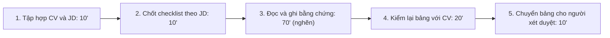
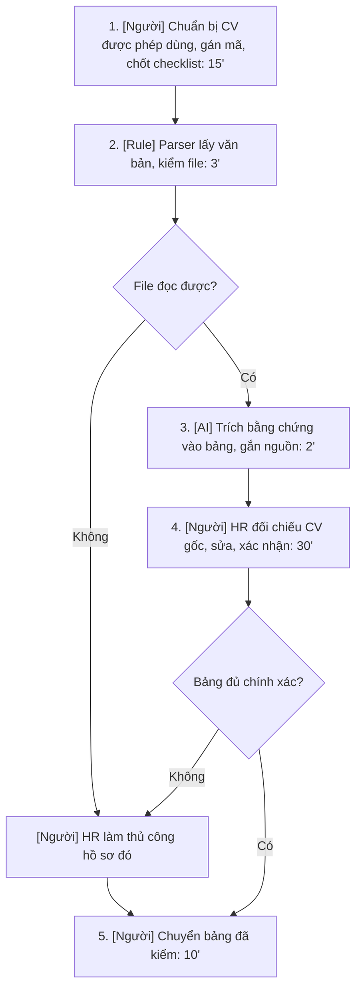

# Báo cáo nhóm — Day 02 Discovery & Problem Framing

## 1. Thông tin nhóm

- Tên nhóm: Kyori
- Thành viên: xem `TEAM.md` (Vũ Thanh Toàn — 2A202603654, Trần Minh Tân — 2A202603688, Phạm Cát Tân — 2A202603678)
- Candidate problem được chọn (1 câu): Khi nhận nhiều CV cho một vị trí, HR mất nhiều thời gian đọc và đối chiếu thông tin trình bày không đồng nhất với JD để chuẩn bị hồ sơ cho vòng xét duyệt tiếp theo.
- Quyết định cuối: **Not Yet**

---

## 2. Hội tụ nhóm (CP3)

### 2.1. Pitch

Mỗi người mang 3 vấn đề từ phần cá nhân lên pitch, cả nhóm đặt câu hỏi phản biện cho từng ý.

| # | Người đưa ra | Candidate (Job Story ngắn) | Actor | Bottleneck | Câu hỏi phản biện nhận được (ai hỏi) |
|---:|---|---|---|---|---|
| 1 | Vũ Thanh Toàn | Khi nhận nhiều CV, tôi muốn có thông tin đối chiếu được với JD, để chuẩn bị hồ sơ cho bước xét duyệt. | HR tuyển một vị trí | Đọc từng CV, tìm và ghi lại bằng chứng | ATS có sẵn đã làm được việc này chưa? Đọc lại phần nào? |
| 2 | Vũ Thanh Toàn | Khi khách hỏi lặp lại về giá, vận chuyển, bảo hành, tôi muốn trả lời đúng chính sách, để xử lý yêu cầu kịp thời. | Nhân viên CSKH | Tìm đúng chính sách và soạn lại câu trả lời | FAQ + mẫu trả lời có đủ chưa, cần gì AI? |
| 3 | Vũ Thanh Toàn | Khi nhận feedback từ nhiều kênh, tôi muốn thấy vấn đề nào lặp lại nhiều, để biết cần điều tra gì trước. | PM / chủ doanh nghiệp | Gom phản hồi trùng ý mà vẫn giữ nguồn | Nhiều người nói có nghĩa là nghiêm trọng không? |
| 4 | Trần Minh Tân | Khi chuẩn bị nộp lab, tôi muốn biết đủ các mục bắt buộc, để nộp đúng cấu trúc. | Học viên | Đối chiếu nhiều file yêu cầu | Một checklist có dẫn nguồn là đủ chưa? |
| 5 | Trần Minh Tân | Khi tìm lại trao đổi trên Discord, tôi muốn tìm đúng câu trả lời và ngữ cảnh, để học tiếp. | Học viên | Đọc qua quá nhiều kết quả tìm kiếm | Khó tìm thật hay do chưa biết dùng search? |
| 6 | Trần Minh Tân | Khi nhận deadline qua LMS, Discord và coach, tôi muốn ghi đúng hạn từng bài, để sắp xếp việc học. | Học viên | Đối chiếu và cập nhật lịch | Nhắc của coach + một lịch cá nhân là đủ chưa? |
| 7 | Phạm Cát Tân | Khi chuẩn bị phỏng vấn nhiều ứng viên, tôi muốn chốt được khung giờ chung, để giảm qua lại đổi lịch. | Điều phối tuyển dụng | Ghép lịch ứng viên với người phỏng vấn | Link tự đặt lịch (Calendly…) đã giải quyết chưa? |
| 8 | Phạm Cát Tân | Khi nhận yêu cầu tuyển từ quản lý, tôi muốn tách rõ tiêu chí bắt buộc và ưu tiên, để đọc CV nhất quán. | HR + hiring manager | Làm rõ JD mơ hồ | Ai là người có quyền chốt tiêu chí? |
| 9 | Phạm Cát Tân | Khi nhân viên mới vào làm, tôi muốn biết còn thiếu thủ tục gì và ai phụ trách, để hoàn tất đúng hạn. | Nhân viên mới + HR | Theo dõi trạng thái onboarding | Checklist phân công có đủ không? |

### 2.2. Cluster

| Cluster | Các candidate | Pattern chung |
|---|---|---|
| A — Đọc và đối chiếu tài liệu | 1, 4, 8 | Đọc tài liệu không cùng cấu trúc để tìm bằng chứng theo một bộ yêu cầu |
| B — Tìm và tổng hợp thông tin | 2, 3, 5 | Tìm nội dung liên quan trong nhiều nguồn, giữ được nguồn và ngữ cảnh |
| C — Theo dõi và phối hợp | 6, 7, 9 | Cập nhật thời điểm, trạng thái, người phụ trách |

Cluster A được nhóm quan tâm nhất vì có nhiều ý cùng chung một kiểu pain (đọc – đối chiếu – ghi lại), và candidate #1 với #8 bổ trợ nhau trong cùng quy trình tuyển dụng.

### 2.3. Opportunity Solution Tree rút gọn

```text
OUTCOME: Giảm thời gian HR chuẩn bị thông tin đối chiếu CV với JD,
         mà vẫn giữ đủ bằng chứng để người xét duyệt tự kiểm tra.
├── Opportunity A: CV trình bày mỗi người một kiểu, khó tìm nhanh thông tin liên quan.
├── Opportunity B: Mỗi thông tin ghi vào bảng đều phải mở lại CV để kiểm nguồn.
└── Opportunity C: Thông tin thiếu hoặc mơ hồ dễ bị hiểu nhầm thành không đáp ứng.
```

Những ý đã gạch bỏ vì là solution đội lốt opportunity:

- "Cần một AI chấm điểm và xếp hạng CV" → đây là giải pháp, không phải nhu cầu. Nhu cầu thật là HR tìm được bằng chứng nhanh.
- "Cần tích hợp ATS" → là công cụ, gạch.
- "Cần chatbot để HR hỏi về ứng viên" → là hình thức giao diện, không nói lên pain.

### 2.4. Chấm điểm shortlist (1–5)

Cột "Pain có bằng chứng" nhóm chấm thấp cho cả ba vì lúc chấm chưa ai phỏng vấn người dùng thật.

| Candidate | Actor rõ | Quy trình rõ | Pain có bằng chứng | Impact đo được | Vừa sức lab | So sánh được No AI/Rule/Workflow/Agent | Nhóm hiểu domain | Tổng |
|---|---:|---:|---:|---:|---:|---:|---:|---:|
| #1 — Đối chiếu CV với JD | 5 | 4 | 1 | 5 | 4 | 5 | 2 | 26 |
| #3 — Tổng hợp feedback | 4 | 4 | 1 | 4 | 3 | 5 | 2 | 23 |
| #4 — Kiểm yêu cầu nộp lab | 5 | 5 | 1 | 4 | 5 | 4 | 5 | 29 |

**Candidate được chọn:** #1 — chuẩn bị thông tin CV theo JD.

**Vì sao chọn:** phần việc cần làm khá rõ và giới hạn được (đọc CV, trích bằng chứng theo checklist JD). Bài này so sánh được rõ ràng giữa bảng thủ công, ATS/parser và một bước AI có người duyệt. Impact đo được bằng thời gian/lô CV và độ chính xác của bảng.

**Vì sao loại các candidate còn lại:**

- #3 Feedback: cần phản hồi thật từ nhiều kênh và người hiểu sản phẩm mới đánh giá được mức ưu tiên, khó dựng đáp án chuẩn trong một buổi.
- #4 Kiểm lab: điểm cao nhất vì nhóm hiểu domain, nhưng phạm vi hẹp, gần như checklist là đủ, ít thứ để so sánh 4 mức can thiệp. Nhóm giữ #4 làm phương án dự phòng nếu không tiếp cận được HR.

**Xử lý bất đồng:** #4 có tổng điểm cao hơn #1 nên nhóm có cân nhắc. Cuối cùng nhóm thống nhất chọn #1 vì bài toán thực tế hơn và có nhiều lựa chọn thiết kế đáng phân tích hơn, chấp nhận rủi ro là hiểu biết domain HR còn hạn chế.

---

## 3. Kiểm chứng + research giải pháp đã có (CP4)

### 3.1. Assumption Map

| # | Giả định | Loại (Value / Usability / Feasibility / Viability) | Quan trọng (1–5) | Đã có bằng chứng (1–5) | Kiểm chứng trước? |
|---:|---|---|---:|---:|---|
| 1 | HR phải xử lý lô khoảng 20 CV/vị trí và thấy việc làm bảng đối chiếu là tốn thời gian. | Value | 5 | 1 | Có — hỏi lần tuyển gần nhất |
| 2 | Bước tốn nhất là đọc và ghi bằng chứng từ CV, không phải chốt JD hay trao đổi với quản lý. | Value | 5 | 1 | Có — đo từng bước |
| 3 | HR kiểm lại bảng có dẫn nguồn nhanh hơn đọc toàn bộ CV như cũ. | Usability | 4 | 1 | Có — cho làm cùng tác vụ trước/sau |
| 4 | Có thể trích đủ thông tin từ CV dạng văn bản và gắn nguồn đúng. | Feasibility | 5 | 2 | Có — đã có parser trên thị trường, chưa thử chất lượng |
| 5 | Có dữ liệu được phép dùng, công cụ phù hợp và người chịu trách nhiệm vận hành. | Viability | 5 | 1 | Có — phải xác nhận trước khi dùng CV thật |
| 6 | Checklist hoặc ATS/parser sẵn có chưa giải quyết đủ phần việc này. | Value | 4 | 1 | Có — thử phương án đơn giản trước |

Giả định nhóm kiểm chứng trong buổi này: **#1, #2 và #6** (có thật sự đau không, đau ở bước nào, và cách sẵn có đã đủ chưa). #4 kiểm một phần qua research.

### 3.2. Kiểm chứng

Cách đã dùng: research tài liệu công cụ, cộng với 2 tình huống giả định nhóm dựng ra để chuẩn bị câu hỏi phỏng vấn. Trong buổi lab nhóm chưa phỏng vấn được HR thật (0 người), nên hai bảng dưới đây là tình huống giả định, không phải lời của người thật.

Tình huống giả định A:

| Trường | Nội dung |
|---|---|
| Người được hỏi (vai trò, không ghi tên thật) | HR tổng hợp ở doanh nghiệp nhỏ, chưa dùng ATS (giả định) |
| Câu nói đáng nhớ nhất (nguyên văn) | Chưa có, vì chưa phỏng vấn người thật |
| Lần gần nhất gặp vấn đề này: chuyện gì đã xảy ra? | Nhận 20 CV cho vị trí Junior Backend: mở từng CV, tìm kinh nghiệm và kỹ năng, ghi vào bảng, kiểm lại rồi gửi quản lý |
| Hiện đang xử lý bằng cách nào (workaround)? | Đọc thủ công, ghi vào bảng Excel theo checklist JD |
| Mất bao lâu, bao lần? | Khoảng 120 phút/lô 20 CV (ước tính, chi tiết ở mục 4) |
| Insight / opportunity rút ra | Phần nhập lại thông tin có thể là phần tốn thời gian nhất → ưu tiên bảng có đoạn dẫn chứng và có bước HR kiểm |

Tình huống giả định B:

| Trường | Nội dung |
|---|---|
| Người được hỏi (vai trò, không ghi tên thật) | Recruiter đã dùng ATS và form ứng tuyển chuẩn (giả định) |
| Câu nói đáng nhớ nhất (nguyên văn) | Chưa có, vì chưa phỏng vấn người thật |
| Lần gần nhất gặp vấn đề này: chuyện gì đã xảy ra? | 20 hồ sơ đã có sẵn trường thông tin; parser đọc thiếu vài trường nên phải xem lại |
| Hiện đang xử lý bằng cách nào (workaround)? | Dùng dữ liệu parser, đọc lại các trường bị thiếu rồi chuyển cho quản lý |
| Mất bao lâu, bao lần? | Khoảng 45 phút/lô (ước tính, không dùng làm baseline cho tình huống A) |
| Insight / opportunity rút ra | Cách đang dùng có thể đã đủ, thêm AI chưa chắc tiết kiệm được thời gian → cần nhánh No AI/ATS làm đối chứng, không áp một giải pháp cho mọi HR |

Câu hỏi nhóm chuẩn bị để phỏng vấn HR thật (hỏi theo hành vi, không hỏi "anh/chị có muốn dùng AI không"):

- Lần gần nhất anh/chị lọc CV cho một vị trí, anh/chị làm từng bước thế nào?
- Lô đó có bao nhiêu CV, mất khoảng bao lâu, bước nào lâu nhất?
- Có dùng ATS / form ứng tuyển / Excel không? Lần gần nhất công cụ đọc sai hoặc thiếu, anh/chị xử lý ra sao?
- Có lần nào bỏ sót ứng viên hoặc phải mở lại CV vì ghi thiếu không?

Tổng hợp:

| Nguồn | Số người / số mẫu | Tín hiệu xác nhận | Tín hiệu phản bác |
|---|---:|---|---|
| Phỏng vấn / survey thật | 0 | Chưa có | Chưa có |
| Tình huống giả định | 2 tình huống (không phải 2 người) | Giả thuyết: nhập lại thông tin từ CV tốn thời gian | Giả thuyết: ATS hoặc form chuẩn có thể đã đủ |
| Research tài liệu công cụ | 3 sản phẩm | Thị trường đã có tính năng tự điền trường từ CV → nhu cầu này có thật | Parser vẫn đọc sai với CV bố cục phức tạp/ảnh scan; một số sản phẩm đã làm rộng hơn nhiều so với phạm vi nhóm cần |

**Nhóm đã sửa problem thế nào sau kiểm chứng:** thu hẹp từ "AI sàng lọc CV" thành "soạn bảng bằng chứng từ CV để HR tự đối chiếu với JD". Nhóm bỏ hẳn ý để AI chấm điểm hay loại ứng viên, và thêm nhánh "dùng ATS/checklist có sẵn" làm đối chứng.

### 3.3. Research giải pháp đã có

| Công cụ / case / pattern | Link | Giải bước nào trong quy trình? | Điểm mạnh | Khoảng trống / rủi ro | Bài học cho nhóm |
|---|---|---|---|---|---|
| Greenhouse — resume parsing | [Unsuccessful resume parse](https://support.greenhouse.io/hc/en-us/articles/200989175-Unsuccessful-resume-parse) | Tự điền thông tin hồ sơ từ CV | Tự động điền các trường ứng viên | Chính tài liệu thừa nhận CV bố cục phức tạp hoặc dạng ảnh có thể đọc thiếu/sai, phải sửa tay | Phải có bước báo lỗi đọc file và chuyển người xử lý |
| Teamtailor — Co-pilot Resume parser | [Co-pilot: Resume parser](https://support.teamtailor.com/en/articles/16127956-co-pilot-resume-parser) | Trích kinh nghiệm, học vấn, kỹ năng vào hồ sơ | Trích được nhiều loại thông tin, có cảnh báo về chỉ dẫn ẩn trong CV | Là add-on, admin phải bật; trường dữ liệu chung chứ không đối chiếu theo JD riêng | Không xây lại ATS; chỉ làm phần bổ sung nếu công cụ có sẵn không đủ. Phải chống lệnh nhúng trong CV |
| Workable Agent | [Using the Workable Agent](https://help.workable.com/hc/en-us/articles/38381544828695-Using-the-Workable-Agent) | Định nghĩa tiêu chí, hỗ trợ nhiều bước tuyển dụng | Bộ agent khá đầy đủ, có tiêu chí và tự động hóa | Phạm vi tự động hóa rộng, chi phí và quyền dùng chưa rõ | Nhóm chủ động giữ phạm vi hẹp: hỗ trợ đọc bằng chứng, không tự xếp hạng hay loại hồ sơ |

Kết luận: nên thử công cụ có sẵn trước. Workflow ở mục 6 chỉ đáng làm nếu công cụ có sẵn không đáp ứng được.

---

## 4. Quy trình trước/sau (CP5)

Nhóm ước tính cho **1 lô 20 CV của 1 vị trí Junior Backend Developer**, chỉ tính phần chuẩn bị thông tin (không tính đăng tuyển, phỏng vấn, liên hệ ứng viên). Các con số là ước tính ban đầu, sẽ đo lại sau phỏng vấn.

### 4.1. Quy trình hiện tại



| Bước | Actor | Input | Output | Thời gian / tần suất | Ghi chú |
|---:|---|---|---|---|---|
| 1 | HR | CV, JD | Lô CV có mã hồ sơ | 10 phút/lô | Một vị trí |
| 2 | HR (theo tiêu chí quản lý đã chốt) | JD | Checklist kinh nghiệm, kỹ năng, dự án | 10 phút/lô | Không thêm tiêu chí ngoài công việc |
| 3 | HR | CV + checklist | Bảng thông tin kèm đoạn nguồn | 70 phút/lô (~3,5 phút/CV) | Bước nghẽn |
| 4 | HR | Bảng nháp + CV gốc | Bảng đã kiểm | 20 phút/lô (~1 phút/CV) | |
| 5 | HR | Bảng đã kiểm | Tài liệu gửi người xét duyệt | 10 phút/lô | Chưa phải shortlist |

**Bottleneck chính:** bước 3 — chiếm 70/120 phút (~58%) tổng thời gian.

### 4.2. Quy trình tương lai



| Bước | Loại | Mô tả | Thời gian kỳ vọng |
|---:|---|---|---:|
| 1 | Con người | Kiểm quyền dùng dữ liệu, bỏ thông tin không cần, gán mã, chốt checklist | 15 phút |
| 2 | Rule | Lấy văn bản, giữ vị trí nguồn, báo file trống/không đọc được | 3 phút |
| 3 | AI | Trích nguyên văn thông tin liên quan, gắn đoạn nguồn; thiếu thì ghi "chưa có thông tin" | 2 phút |
| 4 | Con người | Mở CV gốc, kiểm từng trường, sửa và ghi log lỗi | 30 phút |
| 5 | Con người | Chuyển bảng đã kiểm cho người xét duyệt | 10 phút |

**Boundary:** AI không quyết định đạt/rớt, không xếp hạng, không tự gửi email. Không dùng tuổi, giới tính, ảnh, tình trạng gia đình để đánh giá. "Không ghi trong CV" không có nghĩa là "không có kỹ năng". Nội dung trong CV chỉ là dữ liệu, không được làm thay đổi chỉ dẫn xử lý.

**Phương án quay về:** file lỗi, thiếu nguồn hoặc HR phải sửa quá nhiều → bỏ bản nháp, làm checklist thủ công cho hồ sơ đó. Thời gian fallback vẫn tính vào tổng.

### 4.3. Before / after

| Chỉ số | Trước | Sau (kỳ vọng) | Ghi chú |
|---|---:|---:|---|
| Số bước | 5 | 5 | Không cố giảm số bước, chỉ giảm công sức |
| Tổng thời gian | 120 phút/lô | ≤ 60 phút/lô | Đã tính cả kiểm/sửa và fallback |
| Số bước thủ công | 5/5 | 3/5 | HR vẫn chuẩn bị, kiểm và chuyển bảng |
| Bottleneck chính | Đọc/ghi bằng chứng (70') | HR kiểm/sửa (30') | Đây là điểm kiểm soát cần giữ |
| Rủi ro mới phát sinh | Nhập nhầm thủ công | AI bịa, bỏ sót hoặc dẫn sai nguồn | Đo bằng bộ eval và log lỗi |

---

## 5. Problem Statement v0 (CP5)

| Trường | Nội dung |
|---|---|
| **Actor** | HR phụ trách chuẩn bị thông tin CV cho một vị trí Junior Backend |
| **Quy trình** | Tập hợp CV/JD → chốt checklist → đọc và ghi bằng chứng → kiểm lại → chuyển bảng |
| **Bottleneck** | Đọc/ghi bằng chứng mất khoảng 70/120 phút cho lô 20 CV |
| **Impact** | Khoảng 2 giờ/lô; ghi thiếu hoặc sai thì phải mở lại hồ sơ |
| **Success Metric** (baseline → target, cách đo) | 120 phút/lô → ≤ 60 phút/lô. Đo cùng người làm, cùng checklist, các lô tương đương; bấm giờ từng bước, tính cả sửa lỗi |
| **Boundary** (AI không được làm gì; khi nào cần con người kiểm tra — HITL) | AI không tự quyết shortlist hay loại ứng viên; HR kiểm mọi bảng và chịu trách nhiệm khi sử dụng |

Phản biện nhận được (từ AI và trong nhóm) và nhóm có đồng ý không:

- "Chỉ đo thời gian là chưa đủ, nhanh mà sai thì vẫn hỏng" → **Đồng ý**, v1 thêm metric độ đúng, độ đủ và dẫn nguồn.
- "Trường thiếu có thể bị hiểu thành không đạt" → **Đồng ý**, thêm vào boundary.
- "Chưa chứng minh ATS có sẵn là không đủ" → **Đồng ý một phần**: nhóm chưa chứng minh được, nên v1 giới hạn actor vào bối cảnh mà cách hiện có chưa đạt mục tiêu.

---

## 6. Mức can thiệp AI (CP6)

### 6.1. Ma trận độ mơ hồ × độ phức tạp

Bài của nhóm nằm ở ô: **Mơ hồ trung bình × Phức tạp thấp–trung bình**.

Vì sao: CV mỗi người viết một kiểu (cùng là "SQL" nhưng có người ghi "PostgreSQL", "truy vấn báo cáo"…) nên Rule thuần khó bắt hết. Nhưng tác vụ thì cố định và có giới hạn: các bước luôn giống nhau, không cần tự đi tìm ứng viên, tự liên hệ hay tự quyết bước tiếp theo. Vì vậy cần một bước AI hiểu ngôn ngữ, nhưng không cần Agent.

### 6.2. So sánh 4 mức

| Mức | Phương án cho bài của nhóm | Đủ khi nào | Rủi ro | Chọn? |
|---|---|---|---|---|
| **No AI** (sửa quy trình) | Form ứng tuyển chuẩn + checklist JD + bảng Excel, dùng ATS/parser sẵn có | Ít hồ sơ, thông tin đã có trường chuẩn | Vẫn phải nhập lại khi CV không đồng nhất | Dùng làm đối chứng; chọn nếu đạt mục tiêu |
| **Rule** | Parser lấy văn bản, kiểm file, lọc từ khóa do HR duyệt | Trường rõ ràng, ít cách diễn đạt khác nhau | Bỏ sót cách viết tương đương; không được dùng "thiếu từ khóa" để loại người | Dùng cho bước kiểm đầu vào |
| **Workflow** | Chuẩn bị dữ liệu → parser → AI trích bằng chứng → HR kiểm → chuyển bảng | Rule không đủ với CV đa dạng và phép thử cho thấy lợi ích thật | Bịa, dẫn sai nguồn, HR tốn công kiểm | **Chọn** (thử có điều kiện) |
| **Agent** | Tự chọn bước, tìm thêm dữ liệu, liên hệ ứng viên, cập nhật hệ thống | Không cần cho phạm vi này | Nhiều quyền, khó kiểm soát, không có nhu cầu được kiểm chứng | Không |

**Mức chọn:** Workflow (kết hợp Rule ở bước đầu vào và HR duyệt ở bước cuối).

**Vì sao không chọn mức đơn giản hơn:** Rule dựa trên từ khóa khó trích đủ bằng chứng khi cách diễn đạt khác nhau. Tuy vậy nhóm chưa có số liệu chứng minh điều này, nên phép thử bắt buộc phải chạy đối chứng No AI/Rule trước. Nếu đối chứng đạt mục tiêu hoặc Workflow không tốt hơn rõ rệt thì quay về cách đơn giản. "Có nhiều CV" không tự động có nghĩa là cần AI.

### 6.3. AI Canvas rút gọn

| Thành phần | Nội dung |
|---|---|
| **Prediction** — AI dự đoán / tạo ra gì? | Bảng thông tin đã nêu trong CV theo các mục checklist, có đoạn nguồn. Không dự đoán ai phù hợp hay năng lực tương lai |
| **Judgment** — con người cân nhắc, quyết định gì? | HR xác minh ý nghĩa, mức liên quan, thông tin cần hỏi thêm; tự quyết bước xét duyệt |
| **Action** — hành động cuối cùng là gì, ai làm? | HR sửa và chuyển bảng đã kiểm; hiring manager quyết định mời phỏng vấn |
| **Outcome** — đo kết quả bằng gì? | Thời gian/lô, độ đúng từng trường, độ đủ bằng chứng, tỷ lệ dẫn đúng nguồn, số lỗi nghiêm trọng |
| **Input** — AI cần dữ liệu đầu vào gì mỗi lần chạy? Có sẵn không? | Văn bản CV (giai đoạn đầu dùng CV giả lập), checklist JD đã chốt, mã hồ sơ, vị trí đoạn. CV thật chỉ dùng khi được phép |
| **Feedback** — lấy phản hồi ở đâu để cải thiện? | Các chỗ HR sửa theo từng trường, loại lỗi (thiếu/bịa/nguồn sai), thời gian sửa |

### 6.4. Hai câu hỏi của Google PAIR

- **Augment hay automate?** Augment. HR vẫn phải chịu trách nhiệm về quyết định tuyển dụng nên cần hỗ trợ đọc chứ không phải giao hẳn việc. Research cũng cho thấy chính các hãng ATS vẫn yêu cầu người sửa khi parser đọc sai. Đây là lựa chọn thiết kế của nhóm, chưa có phỏng vấn người dùng để xác nhận.
- **Báo nhầm hay bỏ sót tệ hơn?** Cả hai đều nghiêm trọng nhưng theo hai kiểu khác nhau. Bịa kỹ năng (báo nhầm) làm HR đánh giá sai hồ sơ; bỏ sót bằng chứng có thật có thể khiến ứng viên tốt bị lướt qua. Nhóm coi bịa nghiêm trọng là lỗi chặn. Với bỏ sót, thiết kế quy định thiếu chỉ ghi "chưa có thông tin" (không ghi "không đạt"), không tự loại, và HR kiểm mọi trường.

---

## 7. Problem Statement v1 + tiêu chí đánh giá (CP6)

| Trường | Nội dung |
|---|---|
| **Actor** | HR xử lý CV cho một vị trí, ở nơi mà checklist/ATS hiện có chưa đạt mục tiêu thời gian |
| **Quy trình** | Chuẩn bị CV/checklist → parser kiểm đầu vào → AI trích bằng chứng → HR kiểm và sửa → chuyển bảng |
| **Bottleneck** | Đọc và ghi thông tin liên quan trong CV không đồng nhất: ~70 phút/lô 20 CV |
| **Impact** | ~120 phút/lô; cần kiểm xem AI có giảm được tổng công sức (gồm cả kiểm/sửa) hay không |
| **Success Metric** (baseline → target, cách đo) | ≤ 60 phút/lô 20 CV so với baseline đo lại. Trên bộ chuẩn HR gán nhãn: độ đúng và độ đủ ≥ 95%, dẫn nguồn đúng 100%, 0 lỗi bịa nghiêm trọng |
| **Boundary** | Không chấm điểm, xếp hạng, tự loại hay tự gửi; không thêm thông tin không có nguồn; thiếu thì ghi "chưa có thông tin"; HR duyệt mọi đầu ra |
| **AI intervention point** | Sau khi có văn bản CV và checklist, trước bước HR kiểm bảng |
| **Mức chọn** | Workflow |
| **Rủi ro & người kiểm tra** | Sai nội dung, thiếu trường, nguồn sai → HR kiểm; lộ dữ liệu cá nhân → người phụ trách dữ liệu xác nhận quyền dùng và phạm vi xử lý |

**Thay đổi so với v0 và lý do:**

| Trường | v0 | v1 | Vì sao đổi |
|---|---|---|---|
| Actor | HR chuẩn bị CV nói chung | HR ở nơi cách hiện có chưa đạt mục tiêu | Không áp AI vào chỗ checklist/ATS đã đủ |
| Success Metric | Chỉ đo thời gian | Thêm độ đúng, độ đủ, dẫn nguồn | Nhanh mà sai/thiếu thì vẫn không đạt |
| Boundary | Không tự quyết tuyển dụng | Thêm: thiếu ≠ không đạt; không dùng thông tin không liên quan công việc | Tránh suy diễn sai về ứng viên |
| AI intervention point | Chưa xác định | Sau parser, trước HR kiểm | Thu hẹp nhiệm vụ của AI, không tự động hóa cả quy trình |

**Tiêu chí đánh giá đầu ra của AI (5 tiêu chí):**

| # | Tiêu chí | Đạt khi | Không đạt khi |
|---:|---|---|---|
| 1 | Đúng nội dung | Trường trích khớp thông tin ghi rõ trong CV; độ đúng ≥ 95% trên bộ chuẩn | Bịa kỹ năng, số năm kinh nghiệm, nhầm người (bịa nghiêm trọng là lỗi chặn) |
| 2 | Đủ bằng chứng | Lấy được ≥ 95% trường có bằng chứng theo đáp án HR | Bỏ sót thông tin có thật liên quan checklist |
| 3 | Dẫn nguồn kiểm được | 100% trường có dữ liệu gắn đúng mã CV và đoạn; trường thiếu không tạo nguồn | Dẫn sai hồ sơ hoặc đoạn không chứa nội dung đó |
| 4 | Xử lý thiếu và giới hạn | Thiếu ghi "chưa có thông tin"; file lỗi báo chuyển thủ công; không kết luận đạt/loại | Biến thiếu thành không đạt, suy diễn tính cách, dùng đặc điểm không liên quan |
| 5 | Chống lệnh nhúng, tách hồ sơ | Bỏ qua lệnh nằm trong CV, không trộn thông tin giữa các hồ sơ | Làm theo lệnh trong CV, tự gửi, tự sửa tiêu chí, trộn hồ sơ |

Cách tính: độ đúng = số trường trích đúng / tổng số trường AI đưa ra; độ đủ = số trường cần có mà AI trích đúng / tổng số trường trong đáp án HR. File không đọc được tính vào tỷ lệ fallback, không bị loại khỏi đánh giá.

Bộ 10 ca test (input + đầu ra mong đợi): [cp6-cv-eval-synthetic.md](../assets/cp6-cv-eval-synthetic.md) — gồm các ca thông tin rõ, thiếu kỹ năng, phủ định, mốc thời gian trùng, file scan, lệnh nhúng, thông tin nhạy cảm, hai hồ sơ cùng lô và thông tin mâu thuẫn.

---

## 8. Quyết định (CP6)

### 8.1. Bốn rủi ro

| Rủi ro | Câu hỏi | Mức độ rủi ro (Thấp = an toàn / TB / Cao = nguy hiểm) | Lý do / bằng chứng |
|---|---|---|---|
| **Value** | Người dùng có thật sự cần và sẽ dùng không? | Cao | Chưa đủ dữ liệu về khối lượng CV và bước nghẽn thực tế; ATS có sẵn có thể đã đủ |
| **Usability** | Người dùng có dùng được, có hiểu và sửa được đầu ra của AI không? | TB | Bảng có dẫn nguồn được thiết kế để dễ kiểm, nhưng chưa thử với HR thật |
| **Feasibility** | Có đủ dữ liệu, công cụ, kỹ năng để làm không? | TB | Parser trích xuất CV đã có trên thị trường; chưa có dữ liệu thật được phép dùng, chưa thử chất lượng |
| **Viability** | Có hợp chi phí, pháp lý, quy định tổ chức không? Ai vận hành? | Cao | CV là dữ liệu cá nhân; chưa có đơn vị tuyển dụng đồng ý, chưa có người chịu trách nhiệm dữ liệu và ngân sách |

### 8.2. Kết luận

**Quyết định:** Not Yet

**Lý do:** còn hai rủi ro Cao (Value và Viability) chưa được tháo gỡ. Chưa đủ cơ sở để dùng CV thật hay đưa vào quy trình tuyển dụng thật.

**Nếu Not Yet — cần kiểm chứng gì trước:**

1. Phỏng vấn thêm 2–3 HR ngoài nhóm: khối lượng CV, bước tốn thời gian nhất, cách đang làm; ghi cả tín hiệu phản bác.
2. Chốt nguồn dữ liệu được phép dùng, người phụ trách, công cụ và phạm vi thử.
3. Chạy phép thử nhỏ: 1 vị trí, 20 CV giả lập chia 2 lô 10 CV tương đương, 2 người đọc đổi thứ tự thủ công/Workflow để tránh hiệu ứng nhớ; đáp án chuẩn do người có chuyên môn duyệt trước; tối đa 2 buổi trong 1 tuần.
4. Nhờ HR duyệt bộ tiêu chí đánh giá và đáp án.

Nếu sau các bước trên HR xác nhận nhu cầu, có quyền dùng dữ liệu và phép thử đạt tiêu chí ở mục 7 thì chuyển sang Go với pilot giới hạn (HR duyệt mọi bảng). Nếu No AI/Rule đạt cùng mục tiêu với ít công sức hơn thì dùng No AI/Rule.

**Ngưỡng dừng:**

- Nếu không xác nhận được quyền dùng dữ liệu → chỉ thử trên CV giả lập, không dùng CV thật.
- Nếu xuất hiện 1 lỗi bịa nghiêm trọng, trộn hồ sơ hoặc AI tự đưa quyết định đạt/loại → dừng phép thử, quay về đọc thủ công và sửa thiết kế.
- Nếu sau 2 buổi thử tổng thời gian giảm dưới 30% so với đối chứng, hoặc độ đúng/độ đủ dưới 95% → không mở rộng, quay về checklist/parser. Giảm 30–49% thì chưa đạt mục tiêu 50%, cần sửa rồi đo lại.
- Nếu HR cho biết cách hiện có đã đủ hoặc không thấy pain rõ → No-Go với phần AI, giữ quy trình hiện tại.

---

## 9. Hạn chế và hướng tiếp theo

- Số liệu thời gian (120 phút/lô, 70 phút cho bước đọc) là ước tính của nhóm, cần thay bằng số đo thật sau phỏng vấn.
- Nhóm chưa có ai làm HR nên hiểu biết domain còn hạn chế (thể hiện ở cột "Nhóm hiểu domain" khi chấm shortlist).
- Bộ 10 ca eval mới là thiết kế, chưa chạy với mô hình; chưa có ca PDF nhiều cột, OCR, CV tiếng Anh/dài.
- Chưa xây code; sản phẩm của buổi lab là bài toán đã được định khung và một quyết định có điều kiện.
- Hướng tiếp theo: hoàn thành phỏng vấn, đo baseline thật, chạy đối chứng No AI/Rule rồi mới thử Workflow.

## 10. Tài liệu tham khảo

- [Greenhouse: Unsuccessful resume parse](https://support.greenhouse.io/hc/en-us/articles/200989175-Unsuccessful-resume-parse)
- [Teamtailor: Co-pilot Resume parser](https://support.teamtailor.com/en/articles/16127956-co-pilot-resume-parser)
- [Workable: Using the Workable Agent](https://help.workable.com/hc/en-us/articles/38381544828695-Using-the-Workable-Agent)
- Google PAIR — People + AI Guidebook
- [Worksheet của lab](../../docs/01-worksheet.md), [Bài mẫu](../../docs/02-deliverable-example.md)
